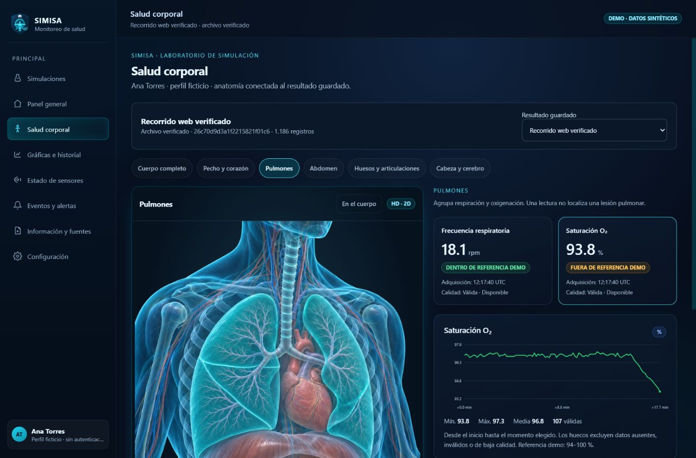
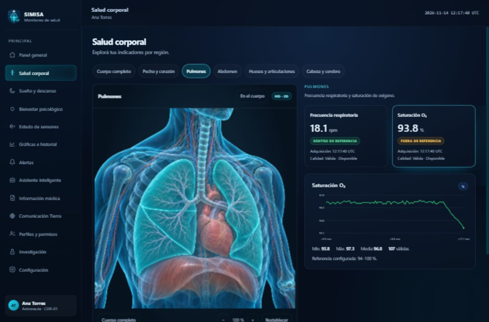

# First walkthrough validation

Date: November 14, 2026. Environment: Windows, Node.js 22.22.1 and the integrated browser. This review covered the new project; historical claims in original documents were not counted as evidence for this version.

[Español](../es/validacion.md) · [Documentation](README.md)

> **Dated record.** This is a translation of recorded checks, not a new validation run. Historical screenshots retain their original Spanish labels. Later language changes are not covered by the browser observations below.

> **Status recorded for the crew version, November 14, 2026:**
>
> - Engine `synthetic-2.3.0`, schema 2 (four crew, prior history, ISS/LEO dosimeter profile), catalog `entrega-1.3.0`. `node --test`: **20 tests, 0 failures**.
> - Examples in `data/runs/`: `23f79084b444cbc2993cfdd1` (Initial walkthrough, seed 2026) and `5891b709a93c234018923c6a` (Verified web walkthrough, seed 31415), each with 14 days of history and 26,544 observations; events affect only Kenji Mori. Dose for the final history day, integrated from saved rates, is 0.84–0.86 and 1.01–1.02 mSv/day, within the 0.4–1.1 mSv/day profile.
> - Previous examples are archived outside the listing and are not published: `data/legacy-1.0.0/`, `data/legacy-1.1.0/`, `data/legacy-2.0.0/`, `data/legacy-2.1.0-previo/`, `data/legacy-2.1.0/`, `data/legacy-2.2.0/`.
> - Sign-in, Crew health center, mission clock, Sensor status and health guidance were reviewed with headless Chrome screenshots and no console errors. Browser observations below refer to the earlier single-subject version (Ana Torres).
> - Exported reports and their counts include sensor measurements only; stress comes from check-ins.
> - Concurrent dispatches of the same report produce one record; damaged activity files are skipped without blocking the rest.
> - Tunnel access restrictions were tested automatically (allowed hosts, origin and read-only mode). An actual `cloudflared` tunnel and browser access through it were still untested.

## Outcome

The sequence configure → run → save to file → stop and restart service → reload app → recover the same run → explore anatomy was completed. The website did not regenerate the series to recover it.

Two examples were available at that review:

| Run | Origin | ID | Observations |
| --- | --- | --- | --- |
| Initial walkthrough | CLI before the website started | `11475e010149e15f639c156a` | 1186 |
| Verified web walkthrough | Web form, seed 31415 | `26c70d9d3a1f2215821f01c6` | 1186 |

Repeating the CLI configuration returned `reused: true` and kept the existing file (observed on engine `1.0.0`; see the later status above).

## Automated tests

At that earlier review, `node --test` reported **8 passed, 0 failed**. The original section subsequently mentioned a 14-test suite; the later crew status above records 20. These numbers refer to different review dates.

1. Exactly equal results for identical settings, including after another scenario; changing the seed changes the data.
2. Delivery units, periodic rates, valid limits, and systolic/diastolic pressure acquired together.
3. Related-indicator episodes, null missing readings, recovery and history preserved across region queries.
4. Invalid readings excluded from current values and indicator conditions.
5. Invalid configurations and incompatible versions rejected.
6. Idempotent saving, read-back verification and visible corruption without overwriting or modification.
7. Creation/query API, process restart, exact recovery and required resource access.
8. CLI execution in an independent process, with identical recovery through two successive web processes stopped between attempts.

`node scripts/verify-originals.js`: **79 originals matched their SHA-256 checksums**, compared with the manifest captured before the new project was created.

## Browser review

| Check | Observed evidence |
| --- | --- |
| Form | Name, scenario, seed, duration, step and UTC start; run and save from the website |
| Real recovery | Web process stopped, a new process started and the page reloaded; same ID and 1186 observations |
| Anatomy | Full body and five detail images loaded at original resolution |
| Shared data | SpO₂ 93.8% at 12:17:40 UTC in anatomy, chart, table and file |
| Disconnection | At 12:39:00 UTC, no current value, disconnected source, last valid 97.0% at 12:38:50 UTC |
| Keyboard zoom | `+` reached 120%; `0` reset the view while retaining results |
| Reduced motion | Preference selected and kept after reload, then restored to its initial value |
| Desktop | Visual review at 1366 × 900 |
| Mobile | 390 × 844; anatomy, simulation, history and settings without horizontal overflow |
| Console | No errors or warnings captured during the walkthrough |

The web run had checksum `e414897ccf95887f8c83e90dedc542d89e26aa55b2655fd6b1e5a3084276b87b`. Observation `spo2:1060` contained 93.8%, valid quality and acquisition time `2026-11-14T12:17:40.000Z`; `spo2:2340` contained `null`, missing quality and disconnected availability. Both were checked against the recovered file.

## Verification limits

These checks establish prototype behavior and persistence on this machine. They are not scientific or clinical validation, a full accessibility audit, all-browser testing or a guarantee against physical disk failure. Authentication, real sensor connections, offline installation and external communications are not promised.

The file preserves individual observations. This version limits each run to 24 hours with a minimum 5-second step. Longer retention or concurrent use requires reviewing format, data volume and storage operation. Numeric references and scenarios remain demonstrative.

## Navigation and presentation update

All 13 original SIMISA_entrega entries were restored and reviewed in the browser. Consultation screens no longer show demo labels, generation parameters or playback controls. Scenario configuration, result selection and playback are grouped in Settings → Simulation. Provenance and limits remain there and in exported files.

- All 13 routes were checked without console errors or warnings.
- Simulation contained one parameter form and one playback-control set.
- Assistant queried the selected history: SpO₂ 93.8% at 12:17:40 UTC, matching the existing file.
- Sleep and Wellbeing show existing records without inventing missing phases, mood or questionnaires.
- Research calculates its table from valid readings; export retains synthetic data origin.
- Communications and Profiles show available integration status without claiming actual external sends or configured accounts.
- Sleep, Wellbeing, Assistant and Settings were checked at 390 × 844 without horizontal overflow.
- The expanded automated suite passed: **14 tests, 0 failures** at that review.
- Vital signs and sleep were verified to come only from sensors: API and storage reject manual entry. `wellbeing` records mood and perceived stress (`self_report`) and feeds views, charts, assistant and reports without altering the simulation file.

The following image superseded the earlier one as the interface reference at that date. Originals outside `simisa-app` remained intact (79/79 SHA-256 verified).

