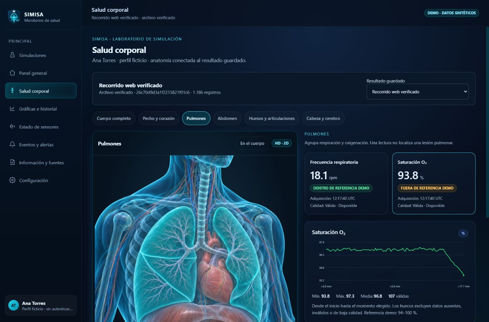
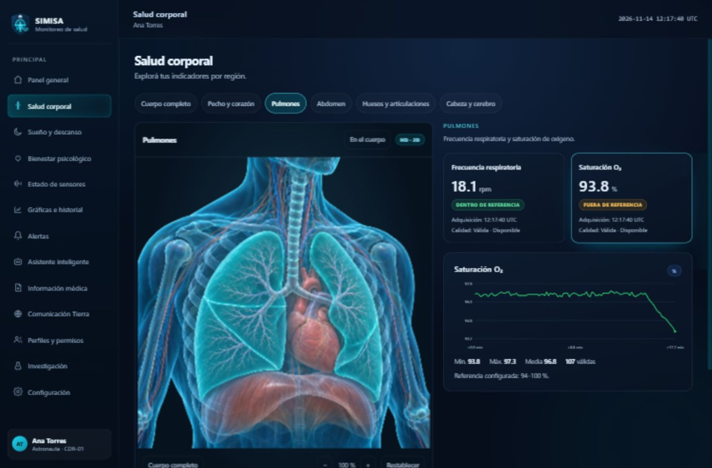

# Validación del primer recorrido

Fecha: 14 de noviembre de 2026. Entorno: Windows, Node.js 22.22.1 y navegador integrado. Se verificó el proyecto nuevo; las afirmaciones históricas de los documentos originales no se contabilizan como pruebas de esta versión.

> **Estado vigente (tripulación, 14/11/2026).** Este documento es un registro fechado: las secciones siguientes describen lo observado en cada revisión. Estado actual:
>
> - Motor `synthetic-2.3.0`, esquema 2 (tripulación de cuatro, historial previo, dosímetro con perfil ISS/LEO), catálogo `entrega-1.3.0`. `node --test`: **20 pruebas, 0 fallos**.
> - Ejemplos en `data/runs/`: `23f79084b444cbc2993cfdd1` (Recorrido inicial, semilla 2026) y `5891b709a93c234018923c6a` (Recorrido web verificado, semilla 31415), con 14 días de historial y 26 544 observaciones cada uno; los eventos corresponden solo a Kenji Mori. La dosis del último día de historial, integrada a partir de las tasas guardadas, es de 0,84–0,86 y 1,01–1,02 mSv/día, dentro del perfil 0,4–1,1 mSv/día.
> - Ejemplos anteriores archivados fuera del listado (no se publican en el repositorio): `data/legacy-1.0.0/`, `data/legacy-1.1.0/`, `data/legacy-2.0.0/`, `data/legacy-2.1.0-previo/`, `data/legacy-2.1.0/` y `data/legacy-2.2.0/`.
> - Pantalla de ingreso, Centro de tripulación, reloj de misión, Estado de sensores y guía de salud revisados con capturas en Chrome sin interfaz, sin errores de consola. Las observaciones de navegador más abajo corresponden a la versión de un solo sujeto (Ana Torres).
> - El informe exportado y su conteo incluyen solo mediciones de sensores; el estrés llega por los chequeos registrados.
> - Envíos simultáneos de un mismo informe registran uno solo; un archivo de actividad dañado se omite sin bloquear el resto.
> - Acceso por túnel probado de forma automática (hosts admitidos, origen y modo solo lectura). No se probó todavía con `cloudflared` real ni en navegador.

## Resultado

Se completó configurar → ejecutar → guardar en archivo → cerrar y reiniciar el servicio → recargar la aplicación → recuperar la misma ejecución → explorar sus resultados en la anatomía. La web no regeneró la serie para recuperarla.

Dos ejemplos quedan disponibles en `data/runs/`:

| Ejecución | Origen | ID | Observaciones |
| --- | --- | --- | --- |
| Recorrido inicial | CLI, antes de iniciar la web | `11475e010149e15f639c156a` | 1186 |
| Recorrido web verificado | Formulario web, semilla 31415 | `26c70d9d3a1f2215821f01c6` | 1186 |

La repetición de la configuración de la CLI devolvió `reused: true` y conservó el archivo existente (comportamiento observado con el motor `1.0.0`; ver “Estado vigente”).

## Pruebas automáticas

`node --test` en esa revisión: **8 pruebas aprobadas, 0 fallos** (la batería actual tiene 14).

1. Igualdad exacta del resultado al repetir la configuración, incluso después de ejecutar otro escenario; una semilla diferente cambia los datos.
2. Unidades de entrega, frecuencias periódicas, límites de valores válidos y presión sistólica/diastólica adquiridas juntas.
3. Episodio relacionado entre indicadores, ausencias nulas, recuperación y preservación del historial al consultar regiones.
4. Lecturas inválidas excluidas del valor actual y de la condición del indicador.
5. Configuraciones inválidas y versiones incompatibles rechazadas.
6. Guardado idempotente, lectura verificada y archivo corrupto visible sin sobrescritura ni modificación.
7. API de creación/consulta, cierre y reinicio del servicio, recuperación exacta y acceso a recursos necesarios.
8. Ejecución de la CLI en proceso independiente y recuperación idéntica mediante dos procesos web sucesivos, cerrados entre intentos.

`node scripts/verify-originals.js`: **79 originales coinciden con sus huellas SHA-256**. Se compararon con el manifiesto tomado antes de crear el nuevo proyecto.

## Revisión de navegador

| Comprobación | Evidencia observada |
| --- | --- |
| Formulario | Nombre, escenario, semilla, duración, paso e inicio UTC; ejecución y guardado desde la web |
| Recuperación real | Se detuvo el proceso web, se inició uno nuevo y se recargó la página; mismo ID y 1186 observaciones |
| Anatomía | Cuerpo completo y cinco imágenes de detalle cargadas con su resolución original |
| Datos compartidos | SpO₂ de 93,8 % a las 12:17:40 UTC en anatomía, gráfica, tabla y archivo |
| Desconexión | A las 12:39:00 UTC: valor actual ausente, fuente desconectada y última válida de 97,0 % a las 12:38:50 UTC |
| Zoom por teclado | `+` produjo 120 % y `0` restableció la vista; se conservó el resultado |
| Movimiento reducido | Preferencia seleccionada, conservada después de recargar; luego devuelta al valor inicial |
| Escritorio | Revisión visual a 1366 × 900 |
| Móvil | 390 × 844; anatomía, simulaciones, historial y configuración sin desbordamiento horizontal |
| Consola | Sin errores ni advertencias capturados durante el recorrido |

La ejecución web tiene huella `e414897ccf95887f8c83e90dedc542d89e26aa55b2655fd6b1e5a3084276b87b`. La observación `spo2:1060` contiene 93,8 %, calidad válida y tiempo de adquisición `2026-11-14T12:17:40.000Z`; `spo2:2340` contiene `null`, calidad ausente y disponibilidad desconectada. Se contrastaron directamente con el archivo recuperado.

## Límites de la verificación

Estas pruebas acreditan el comportamiento del prototipo y su persistencia en este equipo. No son validación científica, evaluación clínica, auditoría completa de accesibilidad, ensayo de todos los navegadores ni garantía ante fallas físicas del disco. No se prometen autenticación, conexión a sensores reales, instalación offline ni comunicación externa.

El archivo conserva observaciones individuales. Esta versión limita cada ejecución a 24 horas y el paso mínimo a 5 segundos. Para retenciones mayores o uso concurrente se deberá revisar el formato, el volumen de datos y la operación del almacenamiento. Las referencias numéricas y los escenarios siguen siendo demostrativos.

## Actualización de navegación y presentación

Se recuperaron las 13 entradas originales de SIMISA_entrega y se revisó cada una en el navegador. Las pantallas de consulta no contienen rótulos de demo, parámetros de generación ni controles de reproducción. La configuración de escenarios, la selección de resultados y la reproducción están únicamente en Configuración → Simulación. Los detalles de procedencia y límites se conservan en ese mismo lugar y en los archivos exportados.

- Se comprobaron las 13 rutas, sin errores ni advertencias de consola.
- La pestaña Simulación mostró exactamente un formulario de parámetros y un conjunto de controles de reproducción.
- El asistente consultó el historial seleccionado: SpO₂ de 93,8 % a las 12:17:40 UTC, coincidente con el archivo ya existente.
- Sueño y Bienestar muestran registros existentes; no se rellenan fases, ánimo ni cuestionarios ausentes.
- Investigación calcula la tabla sobre lecturas válidas. La exportación conserva el origen sintético de los datos.
- Comunicación y Perfiles muestran el estado de las integraciones disponibles; no afirman que haya envíos ni cuentas configuradas.
- A 390 × 844 se verificaron Sueño, Bienestar, Asistente y Configuración sin desbordamiento horizontal.
- La batería automática ampliada pasó: **14 pruebas, 0 fallos**.
- Se verificó que los signos vitales y el sueño provienen únicamente de sensores (rechazando ingresos manuales por API y almacenamiento), mientras que el chequeo psicológico (`wellbeing`) registra estado de ánimo y estrés percibido (`self_report`) y alimenta las vistas, gráficas, asistente e informes sin alterar el archivo de simulación original.

La captura siguiente reemplaza a la anterior como referencia de la interfaz vigente. Los archivos originales fuera de `simisa-app` permanecen intactos (79/79 SHA-256 verificados).

